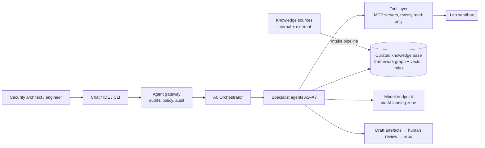

# Agentic Security

> **Status:** Draft v0.4 · Planning phase · Owner: James
> A set of AI agents that help security architects and engineers with threat modelling, architecture review, security documentation, detection engineering, supply-chain intake and automated security testing.

---

## 1. Why this exists

Security architecture work is document-heavy, repetitive and knowledge-intensive. The same analyses (decompose a system, find the trust boundaries, enumerate threats, map controls, write the HLD/LLD, raise findings) are done by hand for every new system. This project builds agents that do the **first 70%** of that work in a consistent, cited, reviewable way, so people spend their time on judgement rather than formatting.

### Goals

| # | Goal | Measured by |
|---|------|-------------|
| G1 | Cut time to a first-draft threat model from days to hours | Elapsed time per spec, reviewer edit distance |
| G2 | Make outputs consistent and traceable to sources | % of findings with a source citation (doc/section/page, ATT&CK/CWE ID) |
| G3 | Reuse organisational knowledge (standards, patterns, past reviews) | Retrieval hit rate on internal corpus |
| G4 | Keep a human accountable for every decision | 100% of outputs pass a named reviewer before use |
| G5 | Do not create a new attack path into the environment | Platform threat model controls implemented and tested |

### Non-goals (for now)

- Autonomous action in production systems (no agent changes prod config, tickets or firewall rules without a human).
- Replacing penetration testers or the security review board.
- Fine-tuning our own foundation model (see [ADR-0001](docs/adr/ADR-0001-retrieval-first.md)).

---

## 1a. What has been built so far

### Copilot Threat Model Agent — [`jfang88/copilot-threat-model-agent`](https://github.com/jfang88/copilot-threat-model-agent)

> **Status:** Working prototype, v2.3 (Nov 2026) · Platform: Microsoft 365 Copilot Agent Builder + code interpreter · Becomes **A1** in this project

A Microsoft 365 Copilot agent that reads design documents and produces a **multi-level threat model with attack paths**. Every element, threat, improvement and question cites document, section, page and a short quote (e.g. `T14 on P3.2, DOC1 §4.3 p.11`).

| Capability | How the prototype does it |
|------------|---------------------------|
| Decomposition | L0 context DFD, then L1/L2 child diagrams only when all three hold: the docs describe 3+ internal parts; the component matters (Critical/High threat, 2+ trust boundaries, sensitive data or AI decisions); the child fits in 15 elements. Never invents internals; raises a question instead |
| Threat method | Same method at every level: STRIDE per element, LINDDUN for personal data, applicable OWASP lists (Top 10:2025, API 2023, LLM 2026, Agentic 2026, CI/CD) |
| Scoring | Likelihood × impact (1–5 each): Critical 20–25 · High 12–19 · Medium 6–11 · Low 1–5 |
| Attack paths | 3–6 paths (AP#) from an external entry point to a business objective, chaining threats across levels; every path must be broken by at least one improvement |
| Traceability | Hierarchical IDs (`P3.2`, `P3.F4`), `refines` links from child to parent threats, reverse links worked out by the generator |
| Validation | `tm_generator.py` stops on `MODEL INVALID` (duplicate or dangling IDs, wrong severity, missing reference) and warns on coverage gaps |
| Outputs | Markdown report, multi-page `.drawio`, editable PowerPoint deck, Excel register, PNGs, `model.json` (re-attachable, keeps IDs), OWASP Threat Dragon v2 JSON |
| Input security | Treats documents as untrusted data; reports any text addressed to an AI as a finding |

**Repo contents:** `agent/` (instructions, loader, generator as text), `generator/tm_generator.py` + `tests/`, `knowledge/` (TM-01 Method and Scoring, TM-02 Threat Library, TM-03 Generator and Schema, TM-04 Worked Example), `examples/` (full sample run: spec → report, deck, register, draw.io, Threat Dragon).

**What this project adds on top:** an evaluation set and scoring (A1 success criteria), more predictable hosting for the generator, links into the shared knowledge base (ATT&CK, CWE, internal standards), and hand-offs to the other agents (A2 review, A3 docs, A4 detections, A7 tests).

**House method:** TM-01 scoring bands, TM-02 framework IDs and the `DOC1 §4.3 p.11` reference format are adopted as the **common method for every agent** in this project.

---

## 2. Design principles

1. **Human-in-the-loop by default.** Agents draft, advise and flag; people approve.
2. **Cite or it didn't happen.** Every finding links to its evidence: an input document location, a framework ID (ATT&CK, CWE, CAPEC, OWASP), or an internal standard.
3. **Retrieval over memorisation.** Knowledge lives in a curated, versioned corpus the agents search, not baked into model weights.
4. **Knowledge is a supply chain.** External datasets go through the same intake discipline as third-party software: provenance, licence, pinning, scanning, validation, periodic recheck ([ADR-0002](docs/adr/ADR-0002-third-party-knowledge-intake.md)).
5. **Least privilege for agents.** Tools are read-only unless a task needs otherwise; write or execute tools are sandboxed and scoped.
6. **Eat our own cooking.** The platform has its own threat model and is held to the same standards we apply to others ([platform threat model](docs/platform-threat-model.md)).
7. **Free / self-hosted first.** Prefer open-source, self-hostable components; note paid or cloud options separately.
8. **Outputs in GitHub-Flavoured Markdown** with Mermaid diagrams and structured tables, so they diff, review and version cleanly.

---

## 3. Agent catalogue (summary)

Full detail in [docs/agent-catalogue.md](docs/agent-catalogue.md).

| ID | Agent | What it does | Autonomy | Phase |
|----|-------|--------------|----------|-------|
| A1 | **Threat Model Agent** | Reads design docs → L0/L1/L2 DFDs, numbered threats (STRIDE, LINDDUN, OWASP), attack paths, improvements, questions, with doc/section/page references. **Prototype v2.3 exists:** [copilot-threat-model-agent](https://github.com/jfang88/copilot-threat-model-agent) | Draft | 1 (harden) |
| A2 | **Architecture Review Agent** | Reviews HLD/LLD against internal standards and patterns (zoning, signing, supply chain, identity) and raises findings | Draft | 2 |
| A3 | **Security Documentation Agent** | Turns notes, diagrams and decisions into HLD/LLD/ADR drafts in house style; checks cross-doc consistency | Draft | 2 |
| A4 | **Detection Engineering Agent** | Turns threats into Sigma/KQL/YARA candidates; validates syntax and tests against sample logs | Draft + sandbox | 3 |
| A5 | **Supply-Chain Intake Agent** | Triages package / binary / dataset intake requests (SBOM, OSV, KEV, licence, signature) and drafts the approval recommendation | Draft | 3 |
| A6 | **Crypto Inventory (CBOM) Agent** | Runs the PQC survey questionnaire per system and scores exposure and ease of algorithm change | Draft | 3 |
| A7 | **Security Test Agent** | Derives test cases from the threat model; runs non-destructive scanners in a lab sandbox only | Sandbox only | 4 |
| A0 | **Orchestrator / Router** | Routes a request to the right agent(s), assembles multi-agent outputs, enforces review gates | Coordinate | 1 |

**Autonomy levels:** *Advise* (answers only) → *Draft* (produces artefacts for review) → *Sandbox* (executes tools in an isolated lab) → *Act* (changes real systems; **out of scope**).

---

## 4. Architecture at a glance

Full detail in [docs/reference-architecture.md](docs/reference-architecture.md).



---

## 5. Knowledge strategy

Agents draw on a **tiered** corpus. Full register in [docs/knowledge-sources.md](docs/knowledge-sources.md).

| Tier | Description | Examples |
|------|-------------|----------|
| T0 | Internal, highest relevance | Security standards, reference architectures, past threat models and reviews, zoning model, signing and supply-chain designs |
| T1 | Authoritative public frameworks | MITRE ATT&CK, ATLAS, CAPEC, CWE, D3FEND; NVD; CISA KEV; NIST; OWASP |
| T2 | Reputable community content | SigmaHQ rules, OSV, vendor security docs |
| T3 | Unverified third-party | Community training datasets (for example `Vyber07/cyber-security`); **on hold until sampled and validated** |

---

## 6. Repository layout (proposed)

```text
AgenticSecurity/
├── README.md
├── docs/
│   ├── agent-catalogue.md
│   ├── reference-architecture.md
│   ├── knowledge-sources.md
│   ├── platform-threat-model.md
│   ├── roadmap.md
│   └── adr/
│       ├── ADR-0001-retrieval-first.md
│       └── ADR-0002-third-party-knowledge-intake.md
├── agents/              # one folder per agent: prompt, tools manifest, eval set
│   └── a1-threat-model/
├── knowledge/
│   ├── register.yaml    # machine-readable source register (pinned versions, hashes)
│   └── intake/          # validation scripts (schema, ID checks, rule compilers)
├── tools/               # MCP server configs / wrappers
├── evals/               # golden inputs + expected outputs, scoring scripts
└── templates/           # output templates (threat model, HLD, LLD, ADR, finding)
```

---

## 7. Documentation index

| Document | Purpose | Status |
|----------|---------|--------|
| [Agent catalogue](docs/agent-catalogue.md) | Each agent's inputs, outputs, tools, knowledge, guardrails and success criteria | Draft |
| [Reference architecture](docs/reference-architecture.md) | Components, trust boundaries, data flows, hosting options | Draft |
| [Knowledge sources](docs/knowledge-sources.md) | Source register, trust tiers, intake pipeline | Draft |
| [Platform threat model](docs/platform-threat-model.md) | Threats to the agent platform itself, and the controls against them | Draft |
| [Roadmap](docs/roadmap.md) | Phases, deliverables, exit criteria | Draft |
| [ADR-0001](docs/adr/ADR-0001-retrieval-first.md) | Retrieval-first, no fine-tuning in early phases | Proposed |
| [ADR-0002](docs/adr/ADR-0002-third-party-knowledge-intake.md) | Third-party knowledge treated as untrusted supply chain | Proposed |

---

## 8. Open decisions

| # | Decision | Options | Notes |
|---|----------|---------|-------|
| D1 | Model platform | Google Vertex AI (existing AI landing zone) · Microsoft 365 Copilot / Copilot Studio (A1 prototype already runs in Agent Builder) · Claude API · mix | Drives data residency, logging and which controls apply |
| D2 | Agent framework | MCP + Claude Agent SDK · Google ADK · Copilot Studio · LangGraph | Prefer something with first-class tool scoping and tracing |
| D3 | Data classification allowed in prompts | Public only · Internal · Confidential with controls | Architecture docs are likely *Confidential* |
| D4 | Vector store / KB hosting | Self-hosted (pgvector, Qdrant, OpenSearch) · managed (Vertex AI Search) | Self-hosted first |
| D5 | Where the repo lives | **Decided (2026-11-25):** public personal GitHub, [`jfang88/AgenticSecurity`](https://github.com/jfang88/AgenticSecurity) | Privately owned work, built in public. No employer-confidential content goes in this repo; organisation-specific T0 material stays in internal stores |
| D6 | Relationship to [`copilot-threat-model-agent`](https://github.com/jfang88/copilot-threat-model-agent) | Keep as A1's own repo and reference it from here · fold into this repo | It's a mature v2.3 prototype; keeping it separate and versioned is the low-friction default |
| D7 | Generator hosting for A1 | Code interpreter (current) · Azure Function called as a Copilot Studio action · container behind the agent gateway | The prototype's README already names the Azure Function route as the predictable option |

---

## 9. Getting started

**Try A1 today:** follow the setup in the [copilot-threat-model-agent README](https://github.com/jfang88/copilot-threat-model-agent#setup-agent-builder-in-microsoft-365-copilot): new agent in Microsoft 365 Copilot → paste `agent/agent_instructions.txt` → upload `knowledge/*.docx` → make sure code interpreter is on → attach a spec. `examples/` has a full sample run to compare against.

*Platform-wide setup to be written once D1/D2 are decided.* Planned flow: clone → configure model endpoint → load T0/T1 corpus → run A1 against a sample spec in `evals/a1/`.

---

## 10. Licence

This project is built in public under two licences:

| What | Licence | File |
|------|---------|------|
| **Code**: agents, prompts, tool configs, scripts, generators, eval harness | [Apache License 2.0](LICENSE) | `LICENSE` |
| **Documentation**: everything in `docs/`, this README, templates, diagrams | [Creative Commons Attribution 4.0 International (CC BY 4.0)](LICENSE-docs) | `LICENSE-docs` |

You may use, adapt and share both, including commercially, as long as you give attribution.

**Third-party material keeps its own terms.** Framework names and IDs (MITRE ATT&CK, ATLAS, CAPEC, CWE; OWASP; NIST) are cited for reference only. Any knowledge-base content pulled from external sources is governed by the licence recorded for it in [knowledge-sources.md](docs/knowledge-sources.md), not by this repo's licences.

---

## 11. Change log

| Version | Date | Change |
|---------|------|--------|
| 0.1 | 2026-11-25 | Initial README and planning document set |
| 0.2 | 2026-11-25 | Linked the copilot-threat-model-agent v2.3 prototype as A1; adopted its TM-01/TM-02 method project-wide; added D7 |
| 0.3 | 2026-11-25 | Added licences: Apache-2.0 (code), CC BY 4.0 (docs) |
| 0.4 | 2026-11-25 | Repo published to GitHub; D5 decided |
