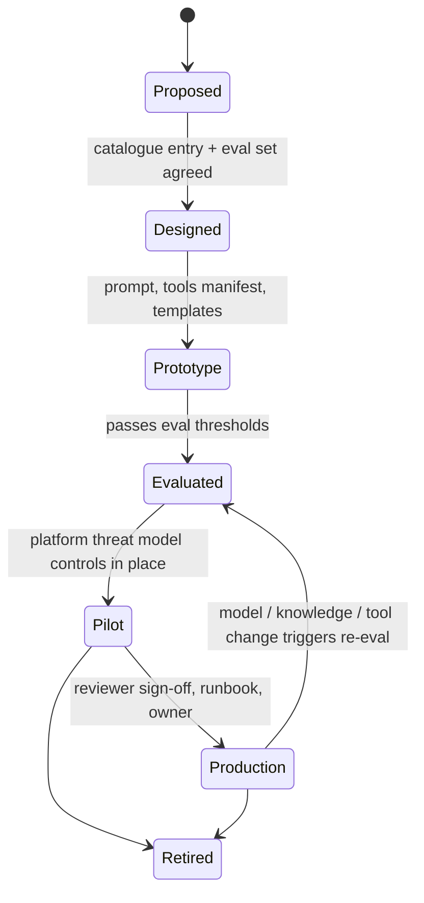

# Agent Catalogue

> **Status:** Draft v0.2 · Part of [Agentic Security](../README.md)

Each agent has a single clear job, a defined input and output, a scoped toolset and an evaluation set. Agents are composed by the orchestrator (A0); they do not call each other directly.

## Common contract (all agents)

| Aspect | Requirement |
|--------|-------------|
| **Output format** | GFM with Mermaid; every artefact starts with a metadata block: agent ID + version, model, knowledge snapshot ID, input hashes, timestamp, reviewer (blank until signed off) |
| **Method** | A1's TM-01 method is the house standard: L × I scoring with Critical 20–25 · High 12–19 · Medium 6–11 · Low 1–5, and framework IDs exactly as listed in TM-02 |
| **Citations** | Every finding cites the input location in A1's format (`DOC1 §4.3 p.11 Table 4`, or `DOC1 gap` where the documents are silent) and, where relevant, a framework ID (OWASP, ATT&CK, CWE, CAPEC) or internal standard clause |
| **Confidence** | Each finding is tagged *High / Medium / Low* confidence, plus a short "assumptions" list |
| **Unknowns** | The agent lists what it could not determine and what it needs. It does not invent detail |
| **Review gate** | Output is marked `DRAFT – NOT REVIEWED` until a named human approves it |
| **Tool default** | Read-only. Anything that writes or executes needs an explicit allow-list and runs in the sandbox |
| **Logging** | Prompts, retrieved chunks, tool calls and outputs go to the audit store ([reference architecture §6](reference-architecture.md#6-observability-audit-and-evaluation)) |

---

## A0 — Orchestrator / Router

| | |
|---|---|
| **Job** | Classify the request, pick the agent or pipeline, pass context, assemble results, enforce review gates |
| **Inputs** | User request + attachments |
| **Outputs** | Routed task(s), combined report, review checklist |
| **Tools** | Agent registry, document store (read), ticket/repo (draft PR only) |
| **Guardrails** | No direct tool execution. Cannot raise any agent's autonomy level. Refuses requests outside the catalogue |
| **Example pipeline** | Spec → **A1** threat model → **A4** detections for High threats → **A3** compiles the LLD security section → human review |

## A1 — Threat Model Agent  *(Phase 1: harden the existing prototype)*

**Built:** [`jfang88/copilot-threat-model-agent`](https://github.com/jfang88/copilot-threat-model-agent), v2.3 (Nov 2026), running in Microsoft 365 Copilot Agent Builder with code interpreter. See [README §1a](../README.md#1a-what-has-been-built-so-far) for a capability summary and `examples/` in that repo for a full sample run.

| | Current (v2.3) | Target in this project |
|---|---|---|
| **Job** | Multi-level threat model with attack paths from attached design documents | Same, plus evaluated quality and hand-offs to A2/A3/A4/A7 |
| **Inputs** | Design docs attached in chat (PDF best for page numbers); optional earlier `model.json` to keep IDs | Plus system classification and links to the internal standards in the KB |
| **Outputs** | Markdown report (DFDs, threat tables, attack paths, review, improvements R#, questions Q#), multi-page `.drawio`, editable `.pptx` deck, `.xlsx` register, PNGs, `model.json`, Threat Dragon v2 JSON | Unchanged. `model.json` becomes the **hand-off format** to other agents |
| **Method** | TM-01: L0 → L1/L2 by decomposition test; STRIDE per element, LINDDUN for personal data, OWASP lists per technology; L × I scoring | Adopted as the **house method** for all agents |
| **Knowledge** | TM-01..TM-04 knowledge files (method, threat library, generator schema, worked example) | Plus T0 internal standards, past threat models, ATT&CK / CWE / CAPEC / ATLAS from the curated KB |
| **Tools** | `tm_generator.py` loaded into code interpreter (validation + all renderers) | Generator hosted predictably (Azure Function action or container behind the gateway, decision D7); structured ID lookup against the KB |
| **Guardrails** | `MODEL INVALID` on duplicate or dangling IDs, wrong severity or missing reference; warnings on coverage gaps; documents treated as untrusted; never invents internals | Plus DRAFT stamp, reviewer sign-off recorded, audit logging (platform controls C06, C15) |
| **Known limits** | Page numbers depend on file format; loading the generator into code interpreter isn't guaranteed; very large doc sets need several runs; simple draw.io layout; files kept for the session only | Address hosting and retention first |

**Success criteria (to measure):** on the eval set, ≥ 80% recall of reviewer-identified High/Critical threats; 0 invented components; 100% of findings referenced (already enforced by the generator); reviewer rates usable as a starting point in ≥ 4 of 5 specs.

**Eval set:** 5–10 past specs with signed-off threat models as gold answers, plus the repo's own `examples/example_spec.md` as a smoke test.

## A2 — Architecture Review Agent  *(Phase 2)*

| | |
|---|---|
| **Job** | Check a design against internal standards and patterns and raise findings |
| **Inputs** | HLD/LLD, applicable standards list, system classification |
| **Outputs** | Findings register: ID, standard clause, observation, evidence (doc location), severity, recommendation, owner (blank). Compliance summary by domain |
| **Review domains** | Network zoning and segmentation · identity and access (Entra, on-prem AD, VDI, B2B) · code and artefact signing · software supply chain · crypto (feeds A6) · logging and monitoring · data protection · AI/LLM use (ties to the AI landing zone) |
| **Knowledge** | T0 standards (primary); T1 NIST CSF 2.0 / SP 800-53, CIS, OWASP ASVS |
| **Guardrails** | A finding must quote the standard clause it relies on. "Best practice" findings with no clause are labelled *advisory* |
| **Success criteria** | Agreement with human reviewers on ≥ 75% of findings; false-positive rate tracked |

## A3 — Security Documentation Agent  *(Phase 2)*

| | |
|---|---|
| **Job** | Draft and maintain security architecture documents in house style |
| **Inputs** | Notes, meeting transcripts, existing docs, decisions, outputs from A1/A2 |
| **Outputs** | HLD, LLD, ADRs, runbooks, using `templates/`. Consistency report across a doc set (terms, component names, versions, contradictions) |
| **Tools** | Repo read; draft PR / branch write only |
| **Guardrails** | Never deletes content without flagging it. Marks generated sections. Keeps a change log |
| **Success criteria** | Reviewer edit distance trending down; zero unflagged contradictions in consistency check |

## A4 — Detection Engineering Agent  *(Phase 3)*

| | |
|---|---|
| **Job** | Turn threats (from A1 or threat intel) into candidate detections |
| **Inputs** | Threat or ATT&CK technique, log sources available, SIEM target |
| **Outputs** | Sigma rule (canonical) + converted KQL / SPL / other via pySigma; YARA where file-based; test case and expected result; ATT&CK mapping; false-positive notes |
| **Tools** | pySigma (convert and validate), `yara` compiler, sample-log replay in sandbox |
| **Knowledge** | T1 ATT&CK data sources; T2 SigmaHQ as reference patterns; T0 log source inventory |
| **Guardrails** | A rule is only `candidate` until it compiles **and** fires on a positive sample **and** stays quiet on a benign sample. Never deploys to production SIEM |
| **Success criteria** | 100% of output rules compile; ≥ 70% pass positive/negative replay on first attempt |

## A5 — Supply-Chain Intake Agent  *(Phase 3)*

Supports the existing controlled-intake design (GitLab approval workflow, Dependency-Track, signature checks).

| | |
|---|---|
| **Job** | Triage an intake request (OSS package, closed-source binary, container image, **AI model or dataset**) and draft the recommendation |
| **Inputs** | Intake request (name, version, source, purpose), artefact or hash |
| **Outputs** | Intake dossier: provenance, licence, SBOM summary, known vulns (OSV, NVD, KEV), signature / Authenticode status, NSRL / reputation, maintainer health, risk rating, recommend approve / conditional / reject |
| **Tools** | Dependency-Track API (read), OSV API, KEV feed, signature verification, hash reputation lookup |
| **Guardrails** | Recommends only; the approval stays with the GitLab workflow. Records the evidence snapshot used |
| **Success criteria** | Matches human decision in ≥ 90% of historical requests; triage time cut |

## A6 — Crypto Inventory (CBOM) Agent  *(Phase 3)*

Supports the PQC exposure survey.

| | |
|---|---|
| **Job** | Run the first-pass crypto survey per system and score PQC exposure |
| **Inputs** | System owner answers, configs, certificates, scan output (TLS scans, cert inventory) |
| **Outputs** | Per-system record: purpose, internet exposure, algorithms and key sizes, ease of change (*config / rebuild / replace product*), data-lifetime sensitivity, dependencies. Roll-up heatmap for the top 20–30 systems. CycloneDX CBOM fragment where possible |
| **Tools** | Questionnaire form, TLS scan parser, certificate parser |
| **Guardrails** | Separates *observed* (from scan or config) and *reported* (from owner) values |

## A7 — Security Test Agent  *(Phase 4, sandbox only)*

| | |
|---|---|
| **Job** | Generate and run security test cases derived from the threat model |
| **Inputs** | Threat model (A1), target in the **lab** environment, rules of engagement |
| **Outputs** | Test plan mapped to threats; results; evidence; findings feed back to the threat model |
| **Tools** | Non-destructive scanners only, e.g. OWASP ZAP baseline, Semgrep, Trivy, Checkov, Nuclei (curated templates) |
| **Guardrails** | Target allow-list enforced at the **network** layer, not just in the prompt. No exploit payload generation against non-lab targets. Rate limits. Kill switch. A human signs off each run |
| **Success criteria** | Zero out-of-scope network attempts; findings reproducible by a human |

---

## Agent lifecycle

**Re-evaluation triggers:** model version change, knowledge snapshot change, new tool, prompt change, or a reviewer-reported miss.
