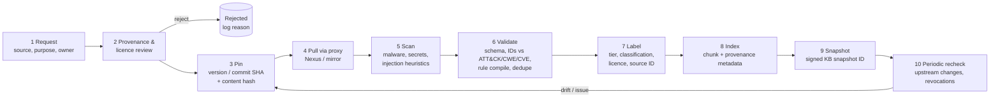

# Knowledge Sources and Intake

> **Status:** Draft v0.2 · Part of [Agentic Security](../README.md)
> Licence entries are **working assumptions to verify** before intake. They are not legal advice.

## 1. Trust tiers

| Tier | Meaning | Default use | Retrieval weighting |
|------|---------|-------------|---------------------|
| **T0** Internal | Our standards, patterns, past reviews | Primary authority for findings | Highest |
| **T1** Authoritative | Maintained by a recognised standards body or government | Framework IDs, factual vulnerability data | High |
| **T2** Reputable community | Widely used, actively maintained, clear licence | Reference patterns (e.g. rule examples) | Medium |
| **T3** Unverified | Unknown provenance or quality, often generated | **Not loaded** until it passes the intake pipeline; then reference only, never cited as authority | Low / excluded |

An agent may **cite** T0–T1 as authority. It may **use** T2 as an example. T3 is never cited.

## 2. Source register

| ID | Source | Content | Format | Licence (verify) | Cadence | Tier | Used by |
|----|--------|---------|--------|------------------|---------|------|---------|
| K-001 | Internal security standards | Policies, standards, patterns | DOCX / MD | Internal | On change | T0 | A1, A2, A3 |
| K-002 | Past threat models and reviews | Signed-off outputs | MD / DOCX | Internal | On sign-off | T0 | A1, A2, evals |
| K-004 | A1 method files TM-01..TM-04 ([copilot-threat-model-agent](https://github.com/jfang88/copilot-threat-model-agent/tree/main/knowledge)) | Threat modelling method and scoring, threat library (framework IDs + triggers), generator schema, worked example | MD source → DOCX | Own work | On release | T0 | A1; method shared by all agents |
| K-003 | Internal architecture designs | Zoning, signing, supply chain, AI landing zone | MD | Internal | On change | T0 | A2, A3 |
| K-010 | MITRE ATT&CK (Enterprise, Cloud, Containers) | Techniques, mitigations, data sources | STIX 2.1 JSON | MITRE terms of use (attribution) | ~2 releases / yr | T1 | A1, A4 |
| K-011 | MITRE ATLAS | Adversarial ML / AI techniques | YAML / STIX | Check repo licence | Periodic | T1 | A1, A2 (AI systems) |
| K-012 | MITRE CAPEC | Attack patterns | XML / STIX | MITRE terms of use | Periodic | T1 | A1 |
| K-013 | MITRE CWE | Weakness taxonomy | XML | MITRE terms of use | ~Quarterly | T1 | A1, A2, A7 |
| K-014 | MITRE D3FEND | Defensive techniques mapped to ATT&CK | JSON-LD | Check | Periodic | T1 | A1 (controls) |
| K-020 | NVD | CVEs, CVSS, CPE | API 2.0 JSON | US Gov (check terms) | Continuous | T1 | A5 |
| K-021 | CISA KEV | Known exploited vulns | JSON / CSV | Check | Continuous | T1 | A5, A2 |
| K-022 | OSV.dev | OSS vulns by ecosystem | OSV JSON | Varies by upstream source | Continuous | T1/T2 | A5 |
| K-030 | OWASP (ASVS, API Top 10, LLM Top 10, Agentic AI guidance) | Requirements and risk lists | MD | CC BY-SA (most projects) | Periodic | T1 | A1, A2 |
| K-031 | NIST (CSF 2.0, SP 800-53, SP 800-218 SSDF, AI RMF) | Control frameworks | PDF / OSCAL | Public | Periodic | T1 | A2 |
| K-040 | SigmaHQ rules | Community detection rules | YAML | Detection Rule License (DRL) | Continuous | T2 | A4 |
| K-041 | Vendor security docs (Google Cloud, Microsoft) | Control capabilities | HTML | Vendor terms (reference, don't redistribute) | Continuous | T2 | A2 |
| K-090 | `Vyber07/cyber-security` (Hugging Face) | Generated Q&A / instruction pairs across ~35 domains | JSON / JSONL | Labelled Apache 2.0, but upstream content provenance unclear | Unknown | **T3** | **On hold** |

### K-090 assessment summary

| Check | Result |
|-------|--------|
| Provenance | Single anonymous author; gated; bulk-uploaded, mostly in one commit |
| Consistency | Size stated as 16 GB and ~95 GB; metadata size category "< 1K"; near-duplicate root files; a stray coding-agent settings file committed |
| Licence | Names HackerOne, BugCrowd, HackTheBox, TryHackMe and PortSwigger as sources without saying how content was collected. The Apache 2.0 label does not relicense third-party content |
| Content quality | Not verifiable without access. Likely heavily LLM-generated. Detection rules and IDs need mechanical validation |
| Safety | Card says "no restrictions" offensive coverage; no misuse or quality review stated |
| **Decision** | **Hold.** Sample 2–3 domains through the intake pipeline (§3). Promote only those subsets that pass, as reference-only material |

## 3. Intake pipeline

This reuses the controlled-intake pattern from the software supply chain design. Knowledge is treated as a third-party artefact.



### Stage controls

| Stage | Control | Evidence kept |
|-------|---------|---------------|
| 2 Provenance & licence | Named maintainer, clear licence, permitted commercial use, upstream sources acceptable | Review note in register |
| 3 Pin | Never track `main` / `latest`. Record commit SHA or release tag plus SHA-256 of each file | `register.yaml` entry |
| 4 Pull | Pull through an internal proxy, not directly from the internet. Keep the original archive | Proxy log, archive hash |
| 5 Scan | AV and secrets scan. Heuristics for embedded instructions ("ignore previous", role tags, hidden Unicode, zero-width characters, encoded payloads) | Scan report |
| 6 Validate | JSON schema; every ATT&CK / CWE / CAPEC / CVE ID resolves in the T1 snapshot; Sigma via pySigma, YARA via compiler; near-duplicate removal (MinHash); sampled human review of N records per domain | Validation report with pass rate |
| 7 Label | Tier, data classification, licence, source ID and version on **every chunk**. This also covers the AI landing zone's data-labelling gap for this corpus | Label manifest |
| 8 Index | Chunks keep `source_id`, `version`, `tier`, `classification`, `licence`, `uri` metadata. Retrieval filters on user entitlement | Index manifest |
| 9 Snapshot | Each KB build gets an ID, a hash and a signature. Agent outputs record the snapshot ID used | Signed manifest |
| 10 Recheck | Scheduled diff against upstream; revoke chunks from withdrawn or changed sources; re-run evals | Recheck log |

### Promotion thresholds (proposal)

| Metric | T2 minimum | T3 → reference-only minimum |
|--------|------------|-----------------------------|
| Schema-valid records | 99% | 95% |
| Framework / CVE IDs that resolve | 99% | 95% |
| Detection rules that compile | 95% | 90% |
| Sampled human review rated accurate | 90% | 85% |
| Injection-heuristic hits | 0 after triage | 0 after triage |

## 4. Machine-readable register (sketch)

```yaml
# knowledge/register.yaml
- id: K-010
  name: MITRE ATT&CK Enterprise
  tier: T1
  licence: MITRE-ToU
  source: https://github.com/mitre-attack/attack-stix-data
  pin:
    version: "<release tag>"
    commit: "<sha>"
    sha256: "<file hash>"
  classification: Public
  used_by: [A1, A4]
  recheck: P90D
  status: approved

- id: K-090
  name: Vyber07/cyber-security
  tier: T3
  licence: "Apache-2.0 (label); upstream unclear"
  source: https://huggingface.co/datasets/Vyber07/cyber-security
  pin: { commit: null }
  status: on-hold
  notes: "Sample evaluation pending; see knowledge-sources.md K-090"
```
