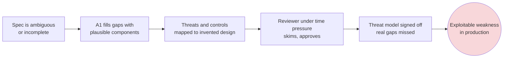
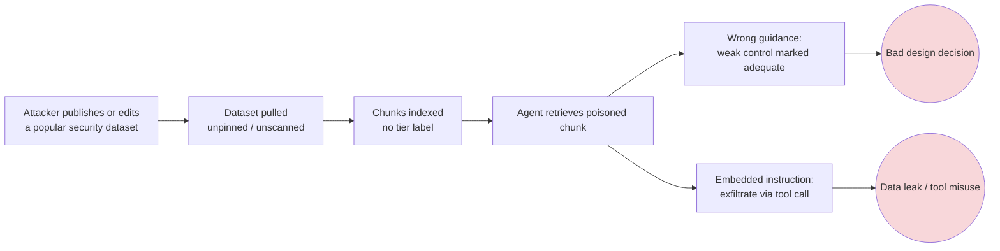
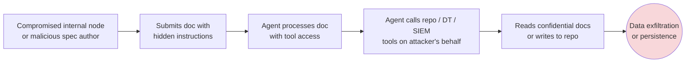

# Platform Threat Model — Agentic Security

> **Status:** Draft v0.2 · Ratings are provisional until hosting (D1) is decided · Part of [Agentic Security](../README.md)
> This models the **agent platform itself**. It holds the platform to the standard its own agents will apply to everyone else.

## 1. Scope

| In scope | Out of scope |
|----------|--------------|
| Gateway, orchestrator, agents A0–A7, knowledge base and intake pipeline, MCP tool layer, lab sandbox, audit store, model access path | Internals of the model provider (covered by vendor assurance); the AI landing zone base controls (covered by its own threat model) |

## 2. Assets

| ID | Asset | Why it matters |
|----|-------|----------------|
| AS1 | Confidential architecture docs and specs (inputs) | They map our defences. High value to attackers |
| AS2 | Knowledge base (T0 internal + curated external) | Integrity drives the correctness of every output |
| AS3 | Agent outputs (threat models, findings, detections) | People act on them. Wrong output means false assurance |
| AS4 | Tool credentials / service identities | Gateway into repo, Dependency-Track, SIEM, sandbox |
| AS5 | Audit logs | Accountability and incident investigation |
| AS6 | Prompts, tool manifests, agent configs | Change them and you change agent behaviour |

## 3. Trust boundaries

TB1 user ↔ gateway · TB2 platform ↔ knowledge · TB3 platform ↔ tools · TB4 platform ↔ model (via landing zone) · TB5 sandbox ↔ everything else · TB6 external sources ↔ intake pipeline. See [reference architecture §2](reference-architecture.md#2-logical-components-l1).

## 4. Threat register

Method and scoring follow **TM-01** from [copilot-threat-model-agent](https://github.com/jfang88/copilot-threat-model-agent): Likelihood (L) × Impact (I), each 1–5. **Critical 20–25 · High 12–19 · Medium 6–11 · Low 1–5.** Framework IDs are cited exactly as in **TM-02** (OWASP LLM Top 10 2026, OWASP Agentic Top 10 2026).

| ID | Threat | STRIDE | OWASP LLM 2026 / Agentic 2026 | Asset | L | I | Score | Severity |
|----|--------|--------|-------------------------------|-------|---|---|-------|----------|
| PT-01 | **Knowledge-base poisoning.** Malicious or wrong content in an external corpus (e.g. a T3 dataset) is indexed and steers agent outputs or carries indirect prompt injection | T | LLM05:2026, LLM09:2026, LLM01:2026; ASI06 | AS2, AS3 | 3 | 5 | 15 | **High** |
| PT-02 | **Indirect prompt injection via input docs.** A spec or attachment contains instructions that make an agent leak data, misuse tools or suppress findings | T, E | LLM01:2026; ASI01 | AS1, AS3, AS4 | 3 | 4 | 12 | **High** |
| PT-03 | **Excessive agency.** An agent with write or execute tools acts beyond its remit (e.g. A7 scanning a non-lab host, A3 overwriting docs) | E | LLM03:2026; ASI02 | AS3, AS4 | 2 | 5 | 10 | Medium |
| PT-04 | **Confidential data leakage.** Specs and retrieved T0 chunks are sent to the model endpoint, logged in the wrong place, or returned to an unentitled user | I | LLM02:2026, LLM09:2026 | AS1 | 3 | 4 | 12 | **High** |
| PT-05 | **False assurance.** Invented components, threats, control mappings or non-functional detection rules are accepted by a reviewer who can't easily verify them | — (output quality; not a STRIDE class) | LLM07:2026; ASI09 | AS3 | 4 | 4 | 16 | **High** |
| PT-06 | **Platform as pivot.** An attacker on a compromised internal node uses legitimate agent / LLM access to reach tools and data, or to persist (inherits the AI landing zone concern) | S, E | LLM03:2026; ASI03 | AS1, AS4 | 2 | 5 | 10 | Medium |
| PT-07 | **Agent supply chain compromise.** Malicious agent framework, MCP server, Python package or container image | T | LLM04:2026; ASI04 | AS4, AS6 | 2 | 5 | 10 | Medium |
| PT-08 | **Config / prompt tampering or extraction.** Unreviewed change to system prompts or tool manifests alters behaviour quietly; hidden instructions are extracted | T, I | LLM08:2026; ASI04 | AS6 | 2 | 4 | 8 | Medium |
| PT-09 | **Insufficient audit.** Can't reconstruct what an agent saw, did or produced | R | — | AS5 | 3 | 3 | 9 | Medium |
| PT-10 | **Cost / resource exhaustion.** Runaway loops or abuse drive model spend or sandbox load | D | LLM06:2026 | Platform | 3 | 2 | 6 | Medium |
| PT-11 | **Cascading failure across agents.** A wrong A1 threat flows into A4 detections and A3 documentation, multiplying the error | T | ASI08 | AS3 | 3 | 3 | 9 | Medium |

## 5. Attack paths (High, plus PT-06)

### PT-05 — False assurance

### PT-01 — Knowledge-base poisoning

### PT-02 / PT-06 — Injection and pivot

## 6. Threat-to-control traceability

| Control | Description | PT-01 | PT-02 | PT-03 | PT-04 | PT-05 | PT-06 | PT-07 | PT-08 | PT-09 | PT-10 | PT-11 | Status |
|---------|-------------|:-----:|:-----:|:-----:|:-----:|:-----:|:-----:|:-----:|:-----:|:-----:|:-----:|:-----:|--------|
| C01 | Knowledge intake pipeline: pin, scan, validate, label, sign snapshot | ● | ○ | | | ○ | | ○ | | | | | Planned |
| C02 | Tiered retrieval; T3 never cited; provenance shown in output | ● | | | | ● | | | | | | | Planned |
| C03 | Input sanitisation and injection detection on docs and chunks; text addressed to an AI reported as a finding | ● | ● | | | | ● | | | | | | **Partly in place** (A1 v2.3 reports it) |
| C04 | Per-agent tool allow-list; read-only default; separate write MCP servers | ○ | ● | ● | | | ● | | | | | | Planned |
| C05 | Sandbox network allow-list enforced at network layer, plus kill switch | | | ● | | | ○ | | | | | | Planned |
| C06 | Human review gate; DRAFT stamp; reviewer identity recorded | | ○ | ● | | ● | | | | ○ | | ● | Planned |
| C07 | Mandatory references; validator rejects uncited elements and findings | ○ | | | | ● | | | | | | ○ | **In place for A1** (`MODEL INVALID`) |
| C08 | Mechanical checks on outputs: IDs resolve, severity matches L × I, rules compile and replay | ● | | | | ● | | | | | | ● | **Partly in place** (A1 generator) |
| C09 | SSO + per-agent RBAC at gateway; device / network posture checks | | ○ | | ● | | ● | | | | | | Planned |
| C10 | Label-aware retrieval (user entitlement filter on chunks) | | | | ● | | ○ | | | | | | Planned |
| C11 | Model endpoint via landing zone or tenant; no-training / retention terms; regional endpoint | | | | ● | | ○ | | | | | | Partly in place (landing zone / M365 tenant) |
| C12 | Behavioural monitoring: volume, unusual tool use, entitlement misses → SIEM | ○ | ● | ○ | ○ | | ● | | | ● | ● | | Planned |
| C13 | Signed prompts, tool manifests, generator and images; verified at deploy (code-signing design) | | | | | | | ● | ● | | | | Planned |
| C14 | Dependency intake for agent stack via controlled repo (Nexus) + SBOM | | | | | | | ● | | | | | Partly in place (supply chain design) |
| C15 | Append-only audit of requests, retrievals, tool calls, outputs, reviews | | | | | | | | | ● | | ○ | Planned |
| C16 | Budgets, rate limits, loop / step caps per run | | | | | | | | | | ● | | Planned |
| C17 | Eval harness: golden sets; regression on every change | ○ | | | | ● | | | ● | | | ● | Planned |
| C18 | Hand-off contract: downstream agents consume validated `model.json` only, never free text | | | | | ○ | | | | | | ● | Planned |

● primary mitigation · ○ contributing

## 7. Residual risk and open questions

- **PT-05 (score 16) stays the top residual risk.** Even with citations and checks, reviewer complacency is a human problem. Consider requiring reviewers to confirm a sample of citations before sign-off.
- Which data classification can go to the model endpoint (README D3)? If *Confidential* is not allowed, A1–A3 need local redaction or a self-hosted model.
- Do we need egress controls on the model endpoint path itself (prompt payloads as an exfiltration channel)?
- How are the platform's own service identities scoped in Entra / on-prem AD?
