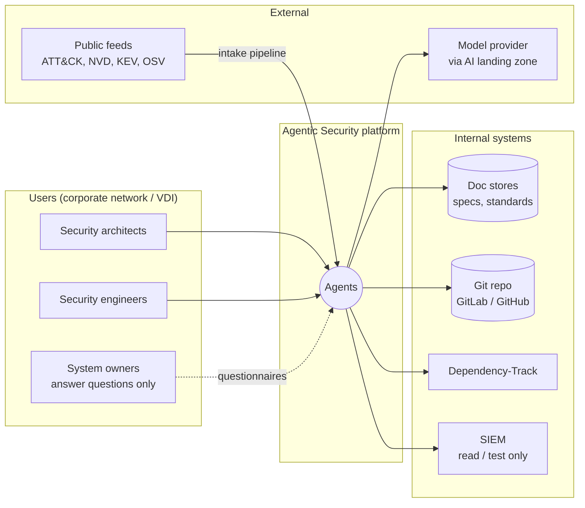
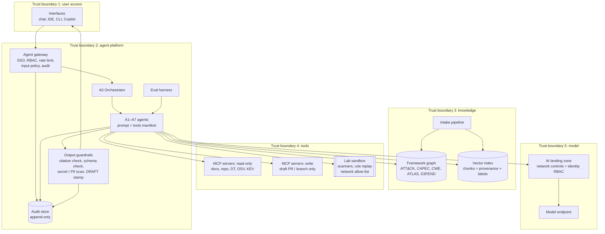

# Reference Architecture

> **Status:** Draft v0.2 · Part of [Agentic Security](../README.md)
> Hosting choices are open (README D1, D2). This document describes the **logical** architecture, which holds whichever platform is chosen.

## 1. Context (L0)

## 2. Logical components (L1)

## 3. Component responsibilities

| Component | Responsibility | Candidate tech (free / self-hosted first) | Paid / cloud alternatives |
|-----------|----------------|-------------------------------------------|---------------------------|
| Agent gateway | AuthN via corporate IdP, per-agent RBAC, rate limit, prompt-injection pre-filter, audit | Reverse proxy + OPA policy; LiteLLM proxy | Apigee, Azure API Management |
| Orchestrator | Routing, multi-agent pipelines, review gates | Claude Agent SDK, Google ADK, LangGraph | Copilot Studio, Vertex AI Agent Builder |
| Framework graph | Structured lookup of IDs and relationships (technique ↔ mitigation ↔ data source) | STIX bundles in a graph or relational DB (Neo4j CE, Postgres) | — |
| Vector index | Semantic retrieval over T0–T2 chunks, carrying provenance + classification labels | pgvector, Qdrant, OpenSearch | Vertex AI Search |
| Intake pipeline | Pull, pin, scan, validate and label knowledge sources ([knowledge-sources §3](knowledge-sources.md#3-intake-pipeline)) | Python jobs in CI; Nexus proxy for upstream pulls | — |
| Tool layer | Scoped access to systems via MCP | Self-hosted MCP servers, one per system, separate read / write | — |
| Lab sandbox | Isolated execution for A4 rule replay and A7 tests | Containers on an isolated K8s namespace with egress deny-by-default | — |
| Output guardrails | Schema and citation validation, secret / PII scan, DRAFT watermark | Custom validators, gitleaks / trufflehog | — |
| Audit store | Prompts, retrievals, tool calls, outputs, reviewer decisions | Append-only object store / OpenSearch, forwarded to SIEM | — |
| Eval harness | Golden-set scoring per agent, regression on change | promptfoo, custom pytest | Vertex AI evaluation |

## 4. Key data flows

| # | Flow | Data | Classification | Control focus |
|---|------|------|----------------|---------------|
| F1 | User → gateway | Request + attached spec | Up to Confidential | SSO, RBAC, DLP labels |
| F2 | Agent → model endpoint | Prompt (spec excerpts + retrieved chunks) | Up to Confidential | Landing zone network controls, no-training / retention terms, regional endpoint |
| F3 | Agent → knowledge | Query / retrieved chunks | Internal–Confidential | Label-aware retrieval: users only get chunks they are entitled to |
| F4 | Agent → tools | Tool calls | Varies | Per-agent tool allow-list, read-only default, scoped service identity |
| F5 | Sources → intake → KB | External corpora | Public / untrusted | Provenance, pinning, scanning, validation ([ADR-0002](adr/ADR-0002-third-party-knowledge-intake.md)) |
| F6 | Agent → repo | Draft artefacts | Confidential | Branch / PR only, signed commits by service identity, human merge |
| F7 | All → audit | Telemetry | Confidential | Append-only, retention policy, SIEM forwarding |

## 5. Hosting options (decision D1)

| Option | Fit | Considerations |
|--------|-----|----------------|
| **Google Vertex AI via existing AI landing zone** | Reuses network and RBAC controls already built | Landing zone gaps apply here too: data labelling not yet in place; abuse of legitimate LLM access from a compromised node |
| **Microsoft 365 Copilot / Copilot Studio** | A1 prototype ([copilot-threat-model-agent](https://github.com/jfang88/copilot-threat-model-agent) v2.3) already runs in Agent Builder; M365 integration | Less control over retrieval and tool scoping; tenant licensing |
| **Claude API (direct or via Vertex)** | Strong document reasoning and tool use; Agent SDK | Same landing zone question if routed via Vertex |
| **Hybrid** | Orchestrator self-hosted, model swappable behind gateway | More moving parts. Keeps us portable. **Recommended direction**, with the gateway abstracting the model |

## 6. Observability, audit and evaluation

- **Trace every run:** request → retrievals (chunk IDs + source versions) → tool calls → model calls → output → reviewer decision.
- **Detect abuse:** alert on unusual volume per identity, tool calls outside an agent's normal pattern, retrieval of chunks above a user's entitlement, and prompts that look like injection attempts.
- **Evaluate continuously:** golden sets per agent in `evals/`; re-run on any model, prompt, tool or knowledge snapshot change; publish scores in the PR.

## 7. Relationship to other workstreams

| Workstream | Relationship |
|------------|--------------|
| Google AI landing zone | Model access path. This platform is a consumer and **inherits its threat model**. |
| Software supply chain security | Intake pipeline reuses the same pattern; A5 supports the intake workflow |
| Enterprise code signing | Agent prompts, tool manifests and container images are signed artefacts. A2 reviews against the signing design |
| Network security zoning | Platform placement and sandbox isolation follow the zoning model |
| PQC / CBOM survey | A6 automates the first-pass survey |
