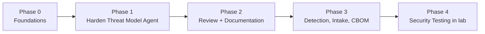

# Roadmap

> **Status:** Draft v0.2 · Part of [Agentic Security](../README.md)
> Phases are gated by exit criteria, not dates. Durations are indicative.

## Phase 0 — Foundations  *(~2–4 weeks)*

| Deliverable | Detail |
|-------------|--------|
| Planning doc set | This README, catalogue, architecture, knowledge register, platform threat model, ADRs |
| Decisions D1–D6 | Model platform, framework, data classification, KB hosting, repo location, fate of the Copilot prototype |
| Repo skeleton | Layout as in README §6; templates for threat model, finding, HLD/LLD, ADR |
| KB v0 | T1 core: ATT&CK, CAPEC, CWE, OWASP; T0: 3–5 internal standards. Built through the intake pipeline, even if the pipeline is a basic script at first |
| A1 eval set | 5–10 past specs with signed-off threat models, plus the prototype's `examples/example_spec.md` as a smoke test |
| K-090 sample | Pull 2–3 domains of `Vyber07/cyber-security` (e.g. `ai-ml-security`, `supply-chain-security`, `cloud-security`) through validation and record the pass rates |

**Exit criteria:** D1, D2 and D3 decided · KB v0 snapshot signed · eval set agreed with at least one other reviewer.

## Phase 1 — Harden the Threat Model Agent  *(~4–6 weeks)*

Starting point: [`copilot-threat-model-agent`](https://github.com/jfang88/copilot-threat-model-agent) v2.3 already delivers L0/L1/L2 DFDs, attack paths, cited findings, validation and seven output formats. Phase 1 is about **proving and hardening** it, not building it.

| Deliverable | Detail |
|-------------|--------|
| A1 baseline eval | Run v2.3 against the eval set; record recall of High/Critical threats, invented components, reviewer usability |
| Generator hosting (D7) | Move `tm_generator.py` out of code-interpreter loading to an Azure Function action or a container behind the gateway, so every run uses the same signed version |
| Output retention | Save outputs to the repo / doc store automatically instead of relying on session-only files |
| KB link-up | Optional ATT&CK / CWE / CAPEC / ATLAS IDs resolved against the curated KB rather than model recall |
| A0 minimal | Single-agent routing + review gate + audit logging |
| `model.json` as hand-off | Document the schema (TM-03) as the contract other agents consume |
| Controls | C04, C06, C09, C11, C15 from the platform threat model |

**Exit criteria:** meets the A1 success criteria in the [catalogue](agent-catalogue.md#a1--threat-model-agent--phase-1-harden-the-existing-prototype) · platform controls for PT-02, PT-04 and PT-05 in place · two pilot reviews on live specs.

## Phase 2 — Architecture Review + Documentation  *(~6–8 weeks)*

| Deliverable | Detail |
|-------------|--------|
| A2 v0.1 | Review against internal standards: zoning, identity, signing, supply chain, AI use |
| A3 v0.1 | HLD/LLD/ADR drafting from notes; consistency checker |
| Pipeline | A1 → A2 → A3 chained via A0 |
| KB v1 | More T0 content (reference architectures, past reviews); NIST CSF 2.0 / 800-53 |

**Exit criteria:** A2 agrees with human reviewers on ≥ 75% of findings · A3 edit distance trending down across three docs.

## Phase 3 — Detection, Supply-Chain Intake, CBOM  *(~8–10 weeks)*

| Deliverable | Detail |
|-------------|--------|
| A4 v0.1 | Sigma-first rules; pySigma conversion; positive/negative replay in sandbox |
| A5 v0.1 | Intake dossier against Dependency-Track / OSV / KEV; includes AI models and datasets as artefact types |
| A6 v0.1 | First-pass PQC survey across the top 20–30 systems |
| Sandbox | Isolated namespace, egress deny-by-default (C05) |

**Exit criteria:** A4 100% compile, ≥ 70% replay pass · A5 ≥ 90% agreement on historical requests · A6 survey completed for the first batch.

## Phase 4 — Security Testing (lab only)  *(TBD)*

| Deliverable | Detail |
|-------------|--------|
| A7 v0.1 | Threat-model-driven test plans; ZAP baseline, Semgrep, Trivy, Checkov in lab |
| Rules of engagement | Written, approved, enforced at the network layer |

**Exit criteria:** zero out-of-scope attempts across the pilot · findings reproduced by a human tester.

## Backlog / ideas

- Threat-intel digest agent (KEV + vendor advisories → "does this affect us?" against the CMDB).
- Control-mapping agent (internal controls ↔ NIST / ISO 27001 / applicable HK and UK requirements).
- Diagram import: draw.io / Visio → DFD elements for A1.
- Reviewer-feedback loop: capture reviewer edits as new eval cases automatically.
